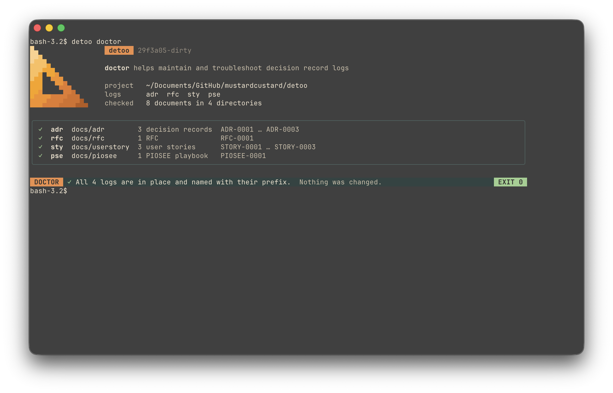

# detoo


[](LICENSE.md)

Command-line tools and agentic skills for working with decision records:

* `adr` keeps [architecture decision records][ADRs]: decisions, and why they
  were made.
* `rfc` keeps requests for comments: proposed changes, written down for
  comment before they are made.
* `sty` keeps [user stories][stories]: who wants something of the software,
  what, and why, with the acceptance criteria that say when it is done.
* `pse` keeps [PIOSEE][piosee] playbooks, each a plan for a situation before
  it arises: the Problem to decide, the Information to gather, the Options,
  how to make the Selection, the steps of Execution, and how to Evaluate the
  result.

## Install

Build from source with Go, which also builds shell completion for each tool:

```bash
make build                  # vet, test and compile into build/
make deploy                 # install into /usr/local (override with PREFIX=)
```

## Usage

Each tool works the same way. Start a log, which by default lives in
`docs/adr`, `docs/rfc`, `docs/userstory` or `docs/piosee`, then add to it:

```bash
adr init
adr new "Use PostgreSQL for persistence"
```

`new` creates the next numbered document from a template, opens it in
`$VISUAL` or `$EDITOR`, and prints its path. Its file name is the log's prefix,
the number and a slug of the title, such as
`ADR-0002-use-postgresql-for-persistence.md`,
`RFC-0004-adopt-connect-for-internal-services.md`,
`STORY-0012-reorder-a-previous-purchase.md` or
`PIOSEE-0004-unexpected-charge-after-deletion.md`. A project can provide its
own template in `templates/template.md` inside the log directory.

A new document can replace or update earlier ones, and the link is recorded
in both:

```bash
adr new --supersede 9 "Use Rust for performance-critical functionality"
rfc new --obsolete 4 "Adopt Connect for internal services"
sty new --replace 12 "Reorder a previous purchase"
pse new --replace 4 "Customer cannot cancel a subscription"
```

Publish a table of contents, or draw the links between documents with Mermaid
or Graphviz:

```bash
adr list --toc > docs/adr/README.md
sty graph | mmdc --input - --output docs/userstory/graph.svg
```

Run `adr help`, or `sty help new`, for each tool's commands and options.

## Agent skills

Install the skills into your project with the
[skills](https://github.com/vercel-labs/skills) CLI:

```bash
npx skills add mustardcustarddev/detoo --skill create-adr --skill review-adrs \
  --skill find-missing-adrs --skill check-adrs --skill create-rfc \
  --skill create-user-story --skill create-piosee
```

They drive the tools for you: writing ADRs, RFCs, user stories and PIOSEE
playbooks, by interviewing you for the reasons rather than guessing them, and
reviewing and checking an ADR log. See the [catalogue](skills/README.md) for
what each one does, and more ways to install them.

> [!TIP]
> Let your agent write the first draft. The skills read the code and the
> existing records, interview you for the context, the options and the
> reasons, and write a complete draft in your project's template. They write
> only what you said or the repository shows, so nothing is invented, and
> every document they create is a Draft for your team to review. A blank
> template becomes a short conversation, and the reasoning behind a decision
> is captured while it is still fresh.

Ask your agent in your own words, for example:

| Prompt                                                                    | Skill               |
| ------------------------------------------------------------------------- | ------------------- |
| "Write an ADR for moving our persistence to PostgreSQL."                  | `create-adr`        |
| "Draft an RFC to migrate the system to hexagonal architecture."           | `create-rfc`        |
| "Write a user story for exporting invoices."                              | `create-user-story` |
| "Write a playbook for when a customer says they've been charged twice."   | `create-piosee`     |
| "Review our ADRs, and tell me which aren't really architectural."         | `review-adrs`       |
| "Find the architecture decisions in this codebase that have no ADR."      | `find-missing-adrs` |
| "Check that the code follows ADR 7."                                      | `check-adrs`        |

## Troubleshooting



```bash
detoo doctor                # check every log directory
detoo doctor --fix          # put right what it finds
```

`detoo doctor` checks that each log directory is where its tool looks for it,
and that each document is named the way its tool expects. It changes nothing,
and exits 1 when it finds a problem, so it can run in CI.

`detoo doctor --fix` moves and renames what is out of place, and updates the
links to it. In a git repository it offers to use `git mv`, so that git
records the renames; `--git` says yes without asking.

## Migrating from ADR Tools

A project that keeps its decisions with [adr-tools][] has them in `doc/adr`,
numbered without a prefix, such as `0001-record-architecture-decisions.md`.
`detoo doctor` finds the discrepancies, and `detoo doctor --fix` fixes them
automatically:

```bash
detoo doctor                # report what is out of place
detoo doctor --fix --git    # git mv doc/adr to docs/adr, rename to ADR-0001-…, update links
adr list                    # adr finds the decisions again
```

The links between decisions, such as `Superseded by`, follow the renamed
files, and so do links to them from a `README.md` or other documents. If you
started adr-tools with a directory of your own, `.adr-dir` names it: if that
is `doc/adr`, delete `.adr-dir` before fixing, or `doctor` will ask you to fix
it by hand. Commit before fixing, so you can review the changes with
`git status` and `git diff`: with `--git`, git shows each file as renamed.

## Thanks

With thanks to Nat Pryce for [adr-tools][], which inspired this project.

## License

Apache License, Version 2.0. See [LICENSE.md](LICENSE.md).

[ADRs]: https://cognitect.com/blog/2011/11/15/documenting-architecture-decisions
[stories]: https://www.mountaingoatsoftware.com/agile/user-stories
[piosee]: https://en.wikipedia.org/wiki/Pilot_decision_making
[adr-tools]: https://github.com/npryce/adr-tools
