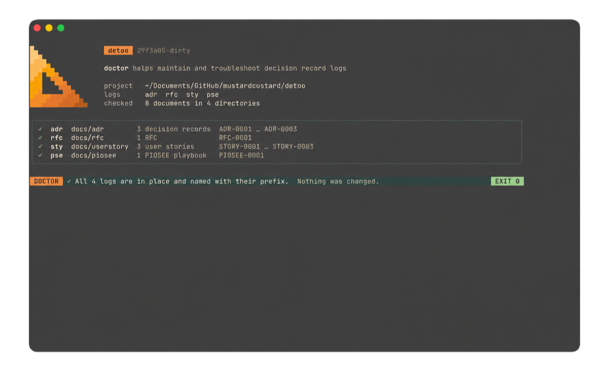

If a tool cannot find its records, or `list` leaves some out, the log is
probably not where the tool looks, or its documents are not named as the
tool expects. `detoo doctor` checks every log in the project at once.



## Check

```bash
detoo doctor
```

`detoo doctor` checks that each log directory is where its tool looks for it,
that each document is named the way its tool expects, and that no two share a
number. It changes nothing, and exits 1 when it finds a problem, so it can run
in CI.

It finds, for example:

* a log kept under `doc/` instead of `docs/`;
* a log in a directory its tool no longer looks in, such as user stories in
  `docs/sty` instead of `docs/userstory`;
* documents whose names do not begin with their log's prefix in upper case,
  such as `STOY-0003-title.md` among the user stories;
* documents that share a number.

## Fix

```bash
detoo doctor --fix
```

`detoo doctor --fix` moves and renames what is out of place, and updates the
links to it. In a git repository it offers to use `git mv`, so that git
records the renames, and to renumber documents that share a number, in the
order git added them. `--git` and `--renumber` say yes without asking.

Renumbering renames documents, so check anything else that refers to them.
Commit before fixing, so that you can review the changes with `git status`
and `git diff`.

When a move would clash, such as when both `docs/sty` and `docs/userstory`
exist, `doctor` reports the problem as needing fixing by hand.

See [`detoo doctor`](../../detoo/doctor/) for every option.
